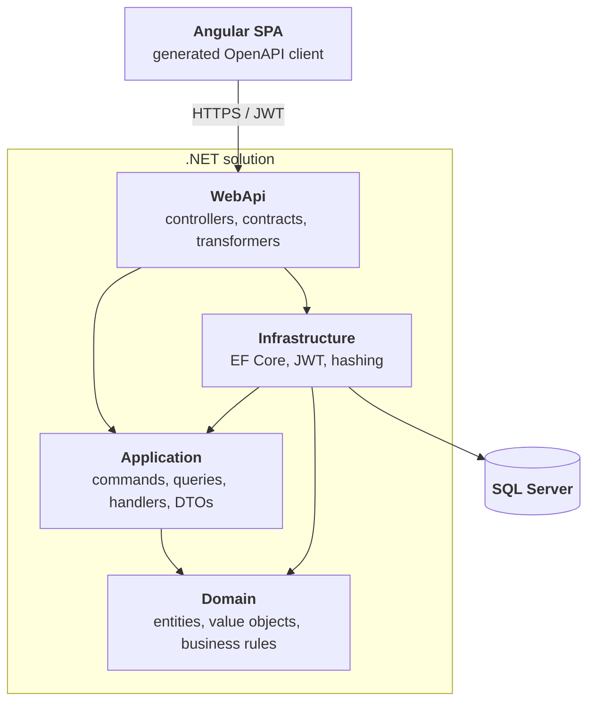

# Ticket Booking Platform

A demo event ticketing platform built as a portfolio project to showcase **.NET backend
engineering with Clean Architecture**, exposing a versioned **REST API** consumed by an
**Angular SPA**.

## Tech stack

### Backend

| Area | Technology |
|---|---|
| Framework | .NET 9 |
| Web | ASP.NET Core Web API|
| Persistence | Entity Framework Core|
| Database | SQL Server |
| Architecture | Clean Architecture|
| API | REST API, OpenAPI + Scalar UI |

### Frontend

| Area | Technology |
|---|---|
| Framework | Angular 22 |
| UI | Angular Material |
| Language / styling | TypeScript, SCSS |
| API client | Generated from OpenAPI |

### Cloud & DevOps

| Area | Technology |
|---|---|
| API hosting | Azure Container Apps |
| SPA hosting | Azure Static Web Apps |
| Database | Azure SQL |
| Migration | Azure Container Apps Job (dedicated migrator) |
| Secrets | Azure Key Vault |
| CI | GitHub Actions, images published to GHCR |
| CD | Automated deployment to Azure on release tag |
| Containers | Docker, Docker Compose |

---

## Roadmap

- [ ] Upgrade to .NET 10 (LTS)
- [x] Docker Compose (SQL Server + API + SPA)
- [ ] FluentValidation for command/query input validation
- [ ] Testcontainers (real SQL Server) for the integration tests
- [x] CI/CD pipeline (build, test, OpenAPI drift check, container image publish)
- [x] Cloud-native readiness (health checks, OpenTelemetry, externalised configuration)
- [x] Deployment to Azure (Container Apps + Azure SQL + Static Web Apps, secrets in Key Vault)

---

## Documentation

The full documentation lives in [docs/documentation.md](docs/documentation.md):

- [Configuration](docs/documentation.md#configuration): settings, environment variables, Key Vault, SPA runtime config
- [Health & observability](docs/documentation.md#health--observability): health endpoints, OpenTelemetry, Aspire Dashboard
- [Continuous integration](docs/documentation.md#continuous-integration): CI jobs, Dependabot
- [Azure deployment](docs/documentation.md#azure-deployment): resources, release flow, OIDC, probes, CORS
- [Getting started](docs/documentation.md#getting-started): also covers the published images and versioning
- [Key technical decisions](docs/documentation.md#key-technical-decisions)
- [Known limitations](docs/documentation.md#known-limitations)

---

## Architecture



```
src/
├── Domain/          Events, Locations, Orders, Tickets, Users + Money / TicketCode value objects
├── Application/     Feature-per-folder CQRS handlers, DTOs, paging helpers, exceptions
├── Infrastructure/  ApplicationDbContext, configurations, migrations, seeding, JWT, hashing
├── Migrator/        Standalone migrator container (applies migrations + seeds before the API starts)
└── WebApi/          V1 & V2 controllers, request contracts, OpenAPI transformers, Program.cs
tests/
├── Domain.Tests/          Aggregate invariants & business rules
├── Application.Tests/     Handler behaviour against EF Core InMemory + NSubstitute doubles
├── Infrastructure.Tests/  Persistence (EF Core on SQLite), seeding, JWT and password hashing
└── WebApi.Tests/          Unit tests + WebApplicationFactory integration tests (auth, versioning, errors, health)
frontend/
└── ticket-booking-web/  Angular SPA
```
