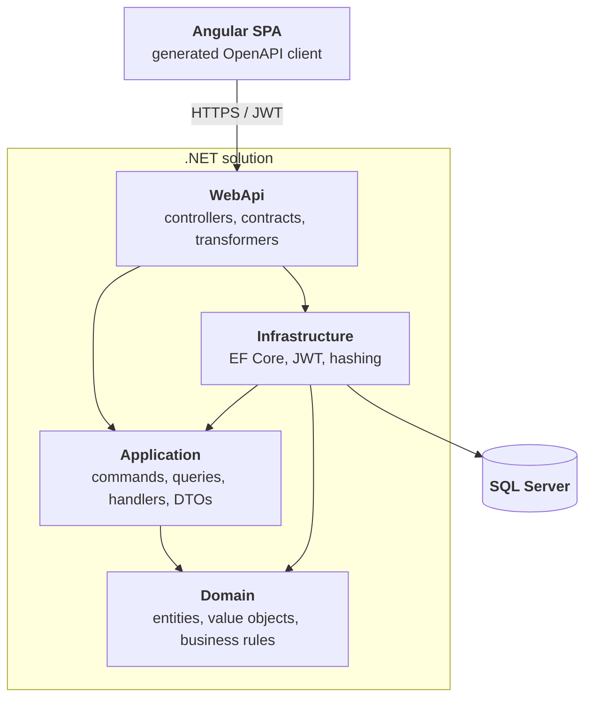

# Ticket Booking Platform

A demo event ticketing platform built as a portfolio project to showcase **.NET backend
engineering with Clean Architecture**, exposing a versioned **REST API** consumed by an
**Angular SPA** through a generated OpenAPI client.

## Feature overview

Event & location management (admin/organizer), event publishing and cancellation, ticket categories
with capacity limits, catalogue browsing with paging and filtering, JWT login, cart and checkout,
order payment/cancellation, and issued tickets with QR codes.

---

## Tech stack

### Backend

| Area | Technology |
|---|---|
| Framework | .NET 9 |
| Web | ASP.NET Core Web API, REST endpoints |
| Persistence | Entity Framework Core 9, code-first migrations |
| Database | SQL Server |
| Architecture | Clean Architecture (Domain / Application / Infrastructure / WebApi) |
| Application layer | CQRS-style commands & queries with hand-written handlers (no MediatR) |
| AuthN / AuthZ | JWT Bearer tokens, role-based policies (`User`, `Organizer`, `Admin`) |
| Password hashing | ASP.NET Core Identity `PasswordHasher` |
| API versioning | URL segment (`/api/v{version}/...`), v1 & v2 documents |
| API docs | Built-in OpenAPI + Scalar UI |
| Error handling | `IExceptionHandler` + RFC 7807 `ProblemDetails` |
| Health checks | ASP.NET Core health checks (`/health/live`, `/health/ready`) |
| Observability | OpenTelemetry traces, metrics and logs exported over OTLP |
| Configuration | Layered `appsettings.json` → user secrets → environment variables |
| Testing | xUnit, FluentAssertions, NSubstitute, EF Core InMemory & SQLite, `WebApplicationFactory` integration tests |

### Frontend

| Area | Technology |
|---|---|
| Framework | Angular 22 |
| UI | Angular Material |
| Language / styling | TypeScript, SCSS |
| API client | Generated from OpenAPI via `openapi-generator-cli` |
| Cross-cutting | HTTP interceptors (auth token, timeout), route guards (`authGuard`, `roleGuard`) |
| Testing | Vitest (via `ng test`) |

---

## Architecture



Dependency rule: `Domain` has no project references. `Application` depends only on `Domain` and
defines its own abstractions (`IApplicationDbContext`, `IJwtTokenGenerator`, `IPasswordHasher`,
`ICurrentUserService`), which `Infrastructure` and `WebApi` implement — so the flow of control
points inward while the flow of dependencies is inverted at the boundaries.

```
src/
├── Domain/          Events, Locations, Orders, Tickets, Users + Money / TicketCode value objects
├── Application/     Feature-per-folder CQRS handlers, DTOs, paging helpers, exceptions
├── Infrastructure/  ApplicationDbContext, configurations, migrations, seeding, JWT, hashing
├── Migrator/        Standalone migrator container (applies migrations + seeds before the API starts)
└── WebApi/          V1 & V2 controllers, request contracts, OpenAPI transformers, Program.cs
tests/
├── Domain.Tests/          Aggregate invariants & business rules
├── Application.Tests/     Handler behaviour against EF Core InMemory + NSubstitute doubles
├── Infrastructure.Tests/  Persistence (EF Core on SQLite), seeding, JWT and password hashing
└── WebApi.Tests/          Unit tests + WebApplicationFactory integration tests (auth, versioning, errors, health)
frontend/
└── ticket-booking-web/  Angular SPA
```

---

## Key technical decisions

- **Clean Architecture over a "services + repositories" CRUD stack.** Business rules live in the
  domain aggregates (`Event.Publish()`, `Order.Pay()`, `TicketCategory` capacity checks), not in
  controllers or handlers.
- **No MediatR.** Handlers are plain classes registered explicitly in `AddApplication()`. It keeps
  the call stack navigable (F12 goes straight to the handler), removes a licensing/runtime
  dependency, and shows the pattern is understood rather than imported.
- **No AutoMapper.** Mapping is explicit (e.g. `OrderMapper`), so projections are compile-time
  checked and there is no reflection-based magic between layers.
- **Domain exceptions mapped centrally.** `BusinessRuleException`, `NotFoundException` and
  `ConflictException` are translated into `ProblemDetails` by a single `GlobalExceptionHandler`,
  so controllers contain no try/catch noise.
- **URL-segment API versioning from day one.** v2 exists to demonstrate coexisting contracts
  (`/api/v1/Events` vs `/api/v2/Events`) with separate OpenAPI documents per version.
- **OpenAPI-driven frontend.** Controllers use explicit action and route names so generated client
  methods stay clean (`getEvents()` rather than `apiV1EventsGet()`); the TypeScript client is
  generated, never hand-written.
- **Secrets stay out of the repo.** Connection string defaults to LocalDB; JWT signing key and the
  seeded admin credentials are read from user secrets / environment variables and the app fails
  fast at startup if they are missing.
- **Migrations are a separate deployment step.** A dedicated `migrator` container (see
  `src/Migrator`) applies migrations and seeds reference data before the API starts, so the API can
  run with multiple replicas without racing on the schema. In-process migration is restricted to the
  Development environment.

---

## Getting started

**Prerequisites:** .NET SDK 9.0+, SQL Server LocalDB (or any SQL Server instance), Node.js 24 for the
frontend (the Angular CLI comes with the project, no global install needed). Optional: Docker for the
containerised stack, and Java 11+ only to regenerate the API client (`npm run generate:api` uses
`openapi-generator-cli`).

```powershell
git clone https://github.com/muszkab/TicketBookingPlatform.git
cd TicketBookingPlatform
```

Configure the required secrets:

```powershell
dotnet user-secrets --project src/WebApi set "JwtSettings:SigningKey" "<at-least-32-character-random-key>"
dotnet user-secrets --project src/WebApi set "Seed:Admin:Email" "admin@example.com"
dotnet user-secrets --project src/WebApi set "Seed:Admin:Password" "<strong-password>"
```

Run the API (in Development it applies migrations and seeds reference data on startup):

```powershell
dotnet run --project src/WebApi
```

| Endpoint | URL |
|---|---|
| API | `https://localhost:5001/api/v1/...` |
| Build & runtime info | `https://localhost:5001/api/v1/meta` (anonymous, feeds the SPA footer) |
| Scalar API reference | `https://localhost:5001/scalar` |
| OpenAPI documents | `/openapi/v1.json`, `/openapi/v2.json` |

Run the tests:

```powershell
dotnet test
```

Run the frontend:

```powershell
cd frontend/ticket-booking-web
npm install
npm start   # https://localhost:4200
```

Or run the whole stack (SQL Server, migrator, API, SPA) with Docker Compose:

```powershell
Copy-Item .env.example .env   # then replace the placeholder secrets
docker compose up -d --build
```

Keep `--build`: without it Compose silently reuses an existing local image, even after code changes.

| Service | URL |
|---|---|
| SPA | `http://localhost:4200` (`SPA_PORT`) |
| API | `http://localhost:8080/api/v1/...` (`API_PORT`) |
| Scalar API reference | `http://localhost:8080/scalar` |

SQL Server publishes no host port. `db/backup` is mounted read-only into the container at
`/var/opt/mssql/backup`, so an existing `.bak` can be restored from there.

---

## Azure deployment

The live system runs on **Azure Container Apps** (API) + **Azure SQL** + **Azure Static Web Apps**
(SPA), with every secret in **Key Vault**. No password exists anywhere: the API and the migrator job
authenticate with their own Managed Identities, and only the migrator may change the schema. Pushing
a `v*.*.*` tag builds, tests and publishes the images, runs the migrator job, then rolls out the new
API revision and the SPA.

---

## Documentation

The full documentation lives in [docs/documentation.md](docs/documentation.md):

- [Configuration](docs/documentation.md#configuration): settings, environment variables, Key Vault, SPA runtime config
- [Health & observability](docs/documentation.md#health--observability): health endpoints, OpenTelemetry, Aspire Dashboard
- [Continuous integration](docs/documentation.md#continuous-integration): CI jobs, Dependabot
- [Azure deployment](docs/documentation.md#azure-deployment): resources, release flow, OIDC, probes, CORS
- [Getting started](docs/documentation.md#getting-started): also covers the published images and versioning

---

## Known limitations

- **Data Protection keys are not persisted.** They live in the container file system, separately per
  replica. This is harmless today (the JWT uses its own symmetric key and the API is stateless), but
  they must move to Blob Storage + Key Vault (`PersistKeysToAzureBlobStorage`,
  `ProtectKeysWithAzureKeyVault`) before cookies, antiforgery tokens or `IDataProtector` are used.
- **Docker Compose connects as `sa`.** Azure already uses least-privilege identities; locally a
  dedicated app login (`db_datareader` / `db_datawriter`) and a migrator login (`db_ddladmin`) are
  still to do.
- **Health responses are plain text**, and the database check has no explicit timeout.
- **`OpenTelemetry.Instrumentation.EntityFrameworkCore` is a beta package**; it should be updated
  once a stable version is released.
- **No admin order management in the SPA yet** (order list, manual status change, refunds).

## Roadmap

- [ ] Upgrade to .NET 10 (LTS)
- [x] Docker Compose (SQL Server + API + SPA)
- [ ] FluentValidation for command/query input validation
- [ ] Testcontainers (real SQL Server) for the integration tests
- [x] CI/CD pipeline (build, test, OpenAPI drift check, container image publish)
- [x] Cloud-native readiness (health checks, OpenTelemetry, externalised configuration)
- [x] Deployment to Azure (Container Apps + Azure SQL + Static Web Apps, secrets in Key Vault)
