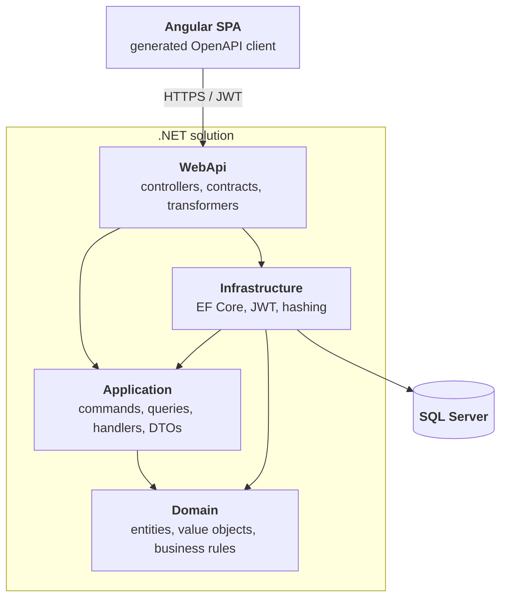

# Ticket Booking Platform

A demo event ticketing platform built as a portfolio project to showcase **.NET backend
engineering with Clean Architecture**, exposing a versioned **REST API** consumed by an
**Angular SPA** through a generated OpenAPI client.

## Feature overview

Event & location management (admin/organizer), event publishing and cancellation, ticket categories
with capacity limits, catalogue browsing with paging and filtering, JWT login, cart and checkout,
order payment/cancellation, and issued tickets with QR codes.

---

## Tech stack

### Backend

| Area | Technology |
|---|---|
| Framework | .NET 9 |
| Web | ASP.NET Core Web API, REST endpoints |
| Persistence | Entity Framework Core 9, code-first migrations |
| Database | SQL Server |
| Architecture | Clean Architecture (Domain / Application / Infrastructure / WebApi) |
| Application layer | CQRS-style commands & queries with hand-written handlers (no MediatR) |
| AuthN / AuthZ | JWT Bearer tokens, role-based policies (`User`, `Organizer`, `Admin`) |
| Password hashing | ASP.NET Core Identity `PasswordHasher` |
| API versioning | URL segment (`/api/v{version}/...`), v1 & v2 documents |
| API docs | Built-in OpenAPI + Scalar UI |
| Error handling | `IExceptionHandler` + RFC 7807 `ProblemDetails` |
| Health checks | ASP.NET Core health checks (`/health/live`, `/health/ready`) |
| Observability | OpenTelemetry traces, metrics and logs exported over OTLP |
| Configuration | Layered `appsettings.json` → user secrets → environment variables |
| Testing | xUnit, FluentAssertions, NSubstitute, EF Core InMemory & SQLite, `WebApplicationFactory` integration tests |

### Frontend

| Area | Technology |
|---|---|
| Framework | Angular 22 |
| UI | Angular Material |
| Language / styling | TypeScript, SCSS |
| API client | Generated from OpenAPI via `openapi-generator-cli` |
| Cross-cutting | HTTP interceptors (auth token, timeout), route guards (`authGuard`, `roleGuard`) |
| Testing | Vitest (via `ng test`) |

---

## Architecture



Dependency rule: `Domain` has no project references. `Application` depends only on `Domain` and
defines its own abstractions (`IApplicationDbContext`, `IJwtTokenGenerator`, `IPasswordHasher`,
`ICurrentUserService`), which `Infrastructure` and `WebApi` implement — so the flow of control
points inward while the flow of dependencies is inverted at the boundaries.

```
src/
├── Domain/          Events, Locations, Orders, Tickets, Users + Money / TicketCode value objects
├── Application/     Feature-per-folder CQRS handlers, DTOs, paging helpers, exceptions
├── Infrastructure/  ApplicationDbContext, configurations, migrations, seeding, JWT, hashing
├── Migrator/        Standalone migrator container (applies migrations + seeds before the API starts)
└── WebApi/          V1 & V2 controllers, request contracts, OpenAPI transformers, Program.cs
tests/
├── Domain.Tests/          Aggregate invariants & business rules
├── Application.Tests/     Handler behaviour against EF Core InMemory + NSubstitute doubles
├── Infrastructure.Tests/  Persistence (EF Core on SQLite), seeding, JWT and password hashing
└── WebApi.Tests/          Unit tests + WebApplicationFactory integration tests (auth, versioning, errors, health)
frontend/
└── ticket-booking-web/  Angular SPA
```

---

## Azure deployment

The live system runs on **Azure Container Apps** (API) + **Azure SQL** + **Azure Static Web Apps**
(SPA), with every secret in **Key Vault**. No password exists anywhere: the API and the migrator job
authenticate with their own Managed Identities, and only the migrator may change the schema. Pushing
a `v*.*.*` tag builds, tests and publishes the images, runs the migrator job, then rolls out the new
API revision and the SPA.

---

## Documentation

The full documentation lives in [docs/documentation.md](docs/documentation.md):

- [Configuration](docs/documentation.md#configuration): settings, environment variables, Key Vault, SPA runtime config
- [Health & observability](docs/documentation.md#health--observability): health endpoints, OpenTelemetry, Aspire Dashboard
- [Continuous integration](docs/documentation.md#continuous-integration): CI jobs, Dependabot
- [Azure deployment](docs/documentation.md#azure-deployment): resources, release flow, OIDC, probes, CORS
- [Getting started](docs/documentation.md#getting-started): also covers the published images and versioning
- [Key technical decisions](docs/documentation.md#key-technical-decisions)
- [Known limitations](docs/documentation.md#known-limitations)

---

## Roadmap

- [ ] Upgrade to .NET 10 (LTS)
- [x] Docker Compose (SQL Server + API + SPA)
- [ ] FluentValidation for command/query input validation
- [ ] Testcontainers (real SQL Server) for the integration tests
- [x] CI/CD pipeline (build, test, OpenAPI drift check, container image publish)
- [x] Cloud-native readiness (health checks, OpenTelemetry, externalised configuration)
- [x] Deployment to Azure (Container Apps + Azure SQL + Static Web Apps, secrets in Key Vault)
