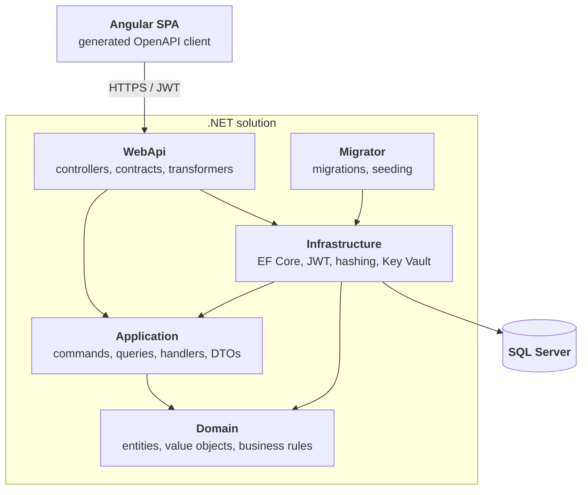

# Architecture

## Layers and dependencies



Dependency rule: `Domain` has no project references. `Application` depends only on `Domain` and
defines its own abstractions (`IApplicationDbContext`, `IJwtTokenGenerator`, `IPasswordHasher`,
`ICurrentUserService`), which `Infrastructure` and `WebApi` implement — so the flow of control
points inward while the flow of dependencies is inverted at the boundaries. `Migrator` is a separate
console application that reuses the persistence setup of `Infrastructure`, see
[Key technical decisions](#key-technical-decisions).

## Project structure

```
src/
├── Domain/          Events, Locations, Orders, Tickets, Users + Money value object, TicketCode generator
├── Application/     Feature-per-folder CQRS handlers, DTOs, paging helpers, exceptions
├── Infrastructure/  ApplicationDbContext, configurations, migrations, seeding, JWT, hashing, Key Vault
├── Migrator/        Standalone migrator container (applies migrations + seeds before the API starts)
└── WebApi/          V1 & V2 controllers, request contracts, OpenAPI transformers, health checks, Program.cs
tests/
├── Domain.Tests/          Aggregate invariants & business rules
├── Application.Tests/     Handler behaviour against EF Core InMemory + NSubstitute doubles
├── Infrastructure.Tests/  Persistence (EF Core on SQLite), seeding, JWT and password hashing
└── WebApi.Tests/          Unit tests + WebApplicationFactory integration tests (auth, versioning, errors, health)
frontend/
└── ticket-booking-web/  Angular SPA
```

## Tech stack

### Backend

| Area | Technology |
|---|---|
| Framework | .NET 9 |
| Web | ASP.NET Core Web API, REST endpoints |
| Persistence | Entity Framework Core 9, code-first migrations |
| Database | SQL Server |
| Architecture | Clean Architecture (Domain / Application / Infrastructure / WebApi) |
| Application layer | CQRS-style commands & queries with hand-written handlers (no MediatR) |
| AuthN / AuthZ | JWT Bearer tokens, role-based authorization (`Customer`, `Organizer`, `Admin`) |
| Password hashing | ASP.NET Core Identity `PasswordHasher` |
| API versioning | URL segment (`/api/v{version}/...`), v1 & v2 documents |
| API docs | Built-in OpenAPI + Scalar UI |
| Error handling | `IExceptionHandler` + RFC 7807 `ProblemDetails` |
| Health checks | ASP.NET Core health checks (`/health/live`, `/health/ready`) |
| Observability | OpenTelemetry traces, metrics and logs exported over OTLP |
| Configuration | Layered `appsettings.json` → user secrets → environment variables → Azure Key Vault (opt-in) |
| Testing | xUnit, FluentAssertions, NSubstitute, EF Core InMemory & SQLite, `WebApplicationFactory` integration tests |

### Frontend

| Area | Technology |
|---|---|
| Framework | Angular 22 |
| UI | Angular Material |
| Language / styling | TypeScript, SCSS |
| API client | Generated from OpenAPI via `openapi-generator-cli` |
| Cross-cutting | HTTP interceptors (auth token, timeout), route guards (`authGuard`, `roleGuard`) |
| Runtime configuration | `config.json` fetched before bootstrap, so one image serves every environment |
| Tickets | QR codes (`angularx-qrcode`), PDF export (`jsPDF`, lazy-loaded) |
| Testing | Vitest (via `ng test`) |

## Key technical decisions

- **Clean Architecture over a "services + repositories" CRUD stack.** Business rules live in the
  domain aggregates (`Event.PutOnSale()`, `Order.Pay()`, `TicketCategory.Reserve()` and the location
  capacity check in `Event.AddTicketCategory()`), not in controllers or handlers.
- **No MediatR.** Handlers are plain classes registered explicitly in `AddApplication()`. It keeps
  the call stack navigable (F12 goes straight to the handler), removes a licensing/runtime
  dependency, and shows the pattern is understood rather than imported.
- **No AutoMapper.** Mapping is explicit (e.g. `OrderMapper`), so projections are compile-time
  checked and there is no reflection-based magic between layers.
- **Domain exceptions mapped centrally.** `BusinessRuleException`, `NotFoundException` and
  `ConflictException` are translated into `ProblemDetails` by a single `GlobalExceptionHandler`,
  so controllers contain no try/catch noise.
- **URL-segment API versioning from day one.** v2 exists to demonstrate coexisting contracts
  (`/api/v1/Events` vs `/api/v2/Events`) with separate OpenAPI documents per version.
- **OpenAPI-driven frontend.** Controllers use explicit action and route names so generated client
  methods stay clean (`getEvents()` rather than `apiV1EventsGet()`); the TypeScript client is
  generated, never hand-written.
- **Secrets stay out of the repo.** Connection string defaults to LocalDB; JWT signing key and the
  seeded admin credentials are read from user secrets / environment variables and the app fails
  fast at startup if they are missing.
- **Migrations are a separate deployment step.** A dedicated `migrator` container (see
  `src/Migrator`) applies migrations and seeds reference data before the API starts, so the API can
  run with multiple replicas without racing on the schema. In-process migration is restricted to the
  Development environment.

## Feature overview

| Who | What |
|---|---|
| Anyone | Browse the event catalogue with paging and filtering (category, status, location), view event details, register, sign in. |
| Signed-in users | Cart and checkout, pay or cancel orders, list own orders (paging, sorting) and tickets, show a ticket's QR code, download it as PDF. |
| Organizers & admins | Create and edit events, manage ticket categories (capacity limited by the location), publish and cancel events. |
| Admins | Manage locations (API only, the SPA has no screen for it yet). |
