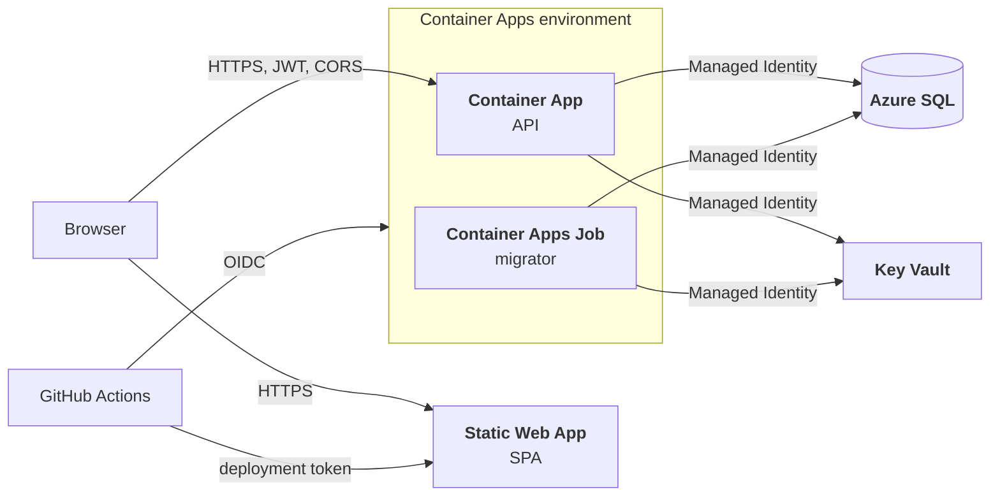

# Azure deployment

The API runs on Azure Container Apps against Azure SQL, with every secret in Key Vault. **No password
exists anywhere in the system** — neither in the images, nor in the app configuration, nor in the
vault: the connection string itself uses a Managed Identity.

Releases are deployed automatically from a git tag, see
[Releasing a new version](ci-cd.md#releasing-a-new-version). This page describes the Azure resources
and the one-time setup the deploy workflows rely on.



## Resources

| Resource | Role |
|---|---|
| Container App (`containerapp-ticketbooking-api`) | Runs the published API image, HTTP ingress on **port 8080**. |
| Container Apps Job (`job-ticketbooking-migrator`) | Manually triggered, one-shot EF Core migration + seeding. `parallelism = 1`, so two migrations can never run at the same time (replica timeout 600 s, 1 retry). |
| Azure SQL Database | Application database, reached with Entra authentication. |
| Key Vault | Connection string, JWT signing key and seed admin password. |
| Static Web App | Hosts the SPA (Free tier) and calls the API directly, with CORS. |
| Log Analytics workspace | Console and system logs of the environment. |

All of them live in the `rg-ticketbooking` resource group. The images come from GHCR, where they are
public, so the Container App and the job need no registry credentials.

## Identities and database permissions

Both the app and the job have their own **system-assigned Managed Identity**, each granted the
**Key Vault Secrets User** role on the vault. The database permissions are deliberately asymmetric:

```sql
-- API: reads and writes data, but cannot change the schema
CREATE USER [<container-app-name>] FROM EXTERNAL PROVIDER;
ALTER ROLE db_datareader ADD MEMBER [<container-app-name>];
ALTER ROLE db_datawriter ADD MEMBER [<container-app-name>];

-- Migrator job: the only identity allowed to change the schema
CREATE USER [<job-name>] FROM EXTERNAL PROVIDER;
ALTER ROLE db_ddladmin   ADD MEMBER [<job-name>];
ALTER ROLE db_datareader ADD MEMBER [<job-name>];
ALTER ROLE db_datawriter ADD MEMBER [<job-name>];
```

Run these statements in the application database, signed in as the **Microsoft Entra admin** of the
SQL server: `FROM EXTERNAL PROVIDER` users can only be created by an Entra identity.

## Configuration

The passwordless connection string stored in the vault (`ConnectionStrings--DefaultConnection`):

```
Server=tcp:<server>.database.windows.net,1433;Initial Catalog=TicketBookingPlatform;Authentication=Active Directory Managed Identity;Encrypt=True;TrustServerCertificate=False;
```

The secrets come from the vault, so the environment variables only hold non-secret settings:

| Where | Environment variables |
|---|---|
| Container App | `KeyVault__Uri`, `ASPNETCORE_ENVIRONMENT=Production`, `ForwardedHeaders__Enabled=true`, `Https__RedirectEnabled=false`, `Https__HstsEnabled=false` (TLS terminates at the ingress), `Cors__AllowedOrigins__0` (see [SPA and CORS](#spa-and-cors)) |
| Migrator job | `KeyVault__Uri`, `Seed__Admin__Email`; optionally `Migrator__SeedDemoData=true` for the demo data |

See [Configuration](configuration.md) for every setting and
[Azure Key Vault](configuration.md#azure-key-vault) for the secret naming.

## Deploying the API

`.github/workflows/deploy-api.yml` signs in to Azure with **OIDC** (a federated credential), so no
client secret is stored in GitHub. The job runs in the `production` GitHub Environment, which is also
what the federated credential trusts. Add *required reviewers* to that environment if you ever want a
manual approval step before a deploy.

One-time Azure setup:

```bash
appId=$(az ad app create --display-name github-ticketbooking-deploy --query appId -o tsv)
az ad sp create --id $appId

az ad app federated-credential create --id $appId --parameters '{
  "name": "github-production",
  "issuer": "https://token.actions.githubusercontent.com",
  "subject": "repo:<owner>@<owner-id>/<repo>@<repo-id>:environment:production",
  "audiences": ["api://AzureADTokenExchange"]
}'

az role assignment create --assignee $appId --role Contributor \
  --scope /subscriptions/<subscription-id>/resourceGroups/rg-ticketbooking
```

The subject must match what GitHub actually presents. For this repository GitHub sends the **ID-based**
form (`repo:<owner>@<owner-id>/<repo>@<repo-id>:environment:production`, the numeric ids come from
`https://api.github.com/repos/<owner>/<repo>`), not the plain `repo:<owner>/<repo>:...` one. If the login
fails with `AADSTS700213`, copy the *subject claim* printed by the `azure/login` step into the credential.

`Contributor` on the resource group covers everything the workflow does: it updates the job image
(`Microsoft.App/jobs/write`), starts the job **without** container overrides
(`Microsoft.App/jobs/start/action`) and updates the Container App.

Prerequisites in the GitHub repository (create the `production` environment first; all three are
**environment secrets** of `production`, like the Static Web Apps token below):

| Kind | Name | Value |
|---|---|---|
| Environment secret | `AZURE_CLIENT_ID` | The `appId` of the app registration above. |
| Environment secret | `AZURE_TENANT_ID` | The Entra tenant id. |
| Environment secret | `AZURE_SUBSCRIPTION_ID` | The subscription that holds `rg-ticketbooking`. |

The resource names (`rg-ticketbooking`, `containerapp-ticketbooking-api`,
`job-ticketbooking-migrator`) are set in the workflow's `env` block.

## Probes

Map the [health endpoints](observability.md#health-endpoints) to the container probes
(`/health/live` for liveness and startup, `/health/ready` for readiness, port `8080`). Give the startup
probe a generous window (an initial delay of about 10 s and a failure threshold of about 30 work
well): the app needs a few seconds to read the vault and warm up, and the first `/health/ready` call
also pays for acquiring the Managed Identity token. "Probe of StartUp failed" entries before that are
just noise.

## SPA and CORS

The SPA is hosted on Azure Static Web Apps and calls the Container App **directly**, so the two run
on different origins and CORS is required. Two settings have to match:

1. The SPA's [`config.json`](configuration.md#spa-runtime-configuration) — `apiBasePath` set to the
   Container App URL.
2. The API — `Cors__AllowedOrigins__0` set to the Static Web Apps URL.

```
Cors__AllowedOrigins__0 = https://<spa-name>.azurestaticapps.net
```

The CORS middleware is only registered when the list is non-empty, which is why local development
and Docker Compose (where nginx proxies `/api/` on the same origin) need no CORS configuration at
all. Every additional origin — a custom domain or a staging slot — needs its own indexed entry
(`Cors__AllowedOrigins__1`, ...); the policy uses `AllowCredentials`, so wildcards are not allowed.

> The alternative would be the Static Web Apps *linked backend* feature, which proxies the API under
> the SPA origin and removes the need for CORS entirely. It requires the Standard plan, so the
> direct-call approach above was chosen instead.

## Deploying the SPA

`.github/workflows/deploy-spa.yml` builds the Angular application from source and uploads it to Static
Web Apps; the SPA image from GHCR is not used in Azure. On a `v*.*.*` tag it is called from `ci.yml`
once the API deploy has succeeded; it can also be run on demand via *Run workflow*.

The workflow writes `config.json` into the build output from the `API_BASE_PATH` variable (a trailing
`/` is removed), so the same source produces the right API URL per environment. A manual run can
override it with the `api_base_path` input; if neither is set, the workflow fails instead of shipping
an SPA without an API URL.

Prerequisites in the GitHub repository:

| Kind | Name | Value |
|---|---|---|
| Environment secret (`production`) | `AZURE_STATIC_WEB_APPS_API_TOKEN` | The deployment token from the Static Web App (*Overview → Manage deployment token*). |
| Environment variable (`production`) | `API_BASE_PATH` | The Container App URL, e.g. `https://<app>.<region>.azurecontainerapps.io`. |

`public/staticwebapp.config.json` handles the routing: unknown paths fall back to `index.html` (the
Angular router owns them) and `config.json` is served with `Cache-Control: no-store`. It also adds
basic security headers (`X-Content-Type-Options`, `X-Frame-Options`, `Referrer-Policy`) to every
response.

When creating the Static Web App in the portal, choose **Deployment source: Other** — the workflow
above already does the build and upload, so Azure should not generate its own.
