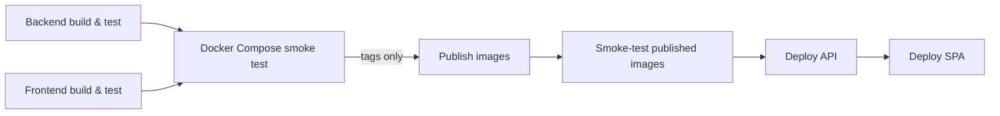

# CI/CD

Everything runs on GitHub Actions. `.github/workflows/ci.yml` builds and tests every change; a
`v*.*.*` tag additionally publishes the images and deploys them to Azure.



## CI jobs

`ci.yml` runs on every push and pull request to `master`, and on `v*.*.*` tags:

| Job | Runs on | What it does |
|---|---|---|
| Backend build & test | every run | Restore, build and `dotnet test` on the solution, with a published test report. On tags the assemblies are built with the release version. |
| Frontend build & test | every run | `npm ci`, `npm test` (Vitest) and `npm run build`. On tags it first sets the `package.json` version from the tag, which also rejects a tag that is not valid semver. |
| Docker Compose smoke test | every run, after both builds | Builds the images and starts the full stack, then checks the migrator exit code, API readiness, the SPA, an anonymous endpoint, the login of the seeded administrator, and that an authenticated endpoint answers `200` with a token and `401` without one. |
| OpenAPI drift check | disabled | Compares the live OpenAPI document with the committed `openapi/v1.json`; switched off (`if: false`) until it is stabilised. |
| Publish images | tags only, after the smoke test | Builds and pushes the `api`, `migrator` and `spa` images to GHCR, see [Versioning and image tags](#versioning-and-image-tags). |
| Smoke-test published images | tags only | Pulls the just-published images with `docker-compose.publishedimage.yml` and waits for API readiness and the SPA. |
| Deploy API, Deploy SPA | tags only | Call `deploy-api.yml` and `deploy-spa.yml`, see [Releasing a new version](#releasing-a-new-version). |

## Dependabot

`.github/dependabot.yml` opens weekly pull requests for NuGet, npm, Docker base images, Compose images
and GitHub Actions. Related packages are grouped into one pull request (e.g. all `@angular/*` packages,
which must always share a version), and a new release is only proposed after a 3-day cooldown, so a
broken or compromised release is usually withdrawn before it reaches the repository.

Major upgrades are ignored on purpose and done by hand:

| Ignored | Why |
|---|---|
| .NET packages (`Microsoft.AspNetCore.*`, `Microsoft.EntityFrameworkCore*`, `Microsoft.Extensions.*`) and the `dotnet/*` images | Tied to the `net9.0` target framework; the upgrade to .NET 10 is a separate task. |
| Angular, `angularx-qrcode` | Done with `ng update`, which also migrates the code. |
| TypeScript (minor versions too) | Must match the range supported by the Angular version. |
| `node` image | Changed together with the Node version of the workflows. |
| FluentAssertions | v8 and later is commercially licensed. |

## Versioning and image tags

The `publish-images` job runs on `v*.*.*` tags only and publishes each image with the full version,
the major.minor and the major tag (e.g. `2.3.0`, `2.3`, `2`). There is deliberately **no `latest`
tag**, so an explicit version has to be pinned for every deployment. The migrator image only exists
from `2.0.0` onwards (it was introduced together with the standalone migrator), so the API and the
migrator must always run the same tag.

The git tag is the single source of truth for the release version, and every artifact bakes it in at
build time: the .NET images via the `APP_VERSION` build arg (`-p:Version`), the SPA via
`scripts/generate-version.cjs`. The SPA footer shows the SPA build version, its tooltip adds the
commit, the build date and the API version reported by `/api/v1/meta` — so a mismatch between the
SPA and the API is visible at a glance.

## Releasing a new version

Tag the commit and push the tag:

```powershell
git tag v2.5.0
git push origin v2.5.0
```

From there the pipeline is automatic:

1. CI builds and tests, publishes the images and smoke-tests them.
2. `deploy-api.yml` points the migrator job at the new image, **runs it to completion**, and only then
   creates the new API revision. Container Apps routes traffic once `/health/ready` reports healthy
   and the previous revision stays active if the new one never does. The workflow finishes when
   `GET /api/v1/meta` reports the released version and `/health/ready` answers 200; on failure it
   prints the revisions and the last log lines.
3. `deploy-spa.yml` builds the SPA from the tagged source and uploads it to Static Web Apps — only
   after the API is live.

A failed migration stops the pipeline before the API or the SPA change. A database migration does
not roll back with the revision, and the old API briefly runs against the new schema, so migrations
must stay backwards compatible with the previous release (expand first, contract in a later release).

Both deploy workflows can also be started by hand (*Run workflow*); `deploy-api.yml` asks for the
version to deploy, which makes a redeploy or a rollback to an older release a single click. Deploys
of the same kind are queued, never run in parallel and never cancelled halfway.

The one-time Azure and GitHub setup the deploy workflows need is described in
[Azure deployment](documentation.md#azure-deployment).
