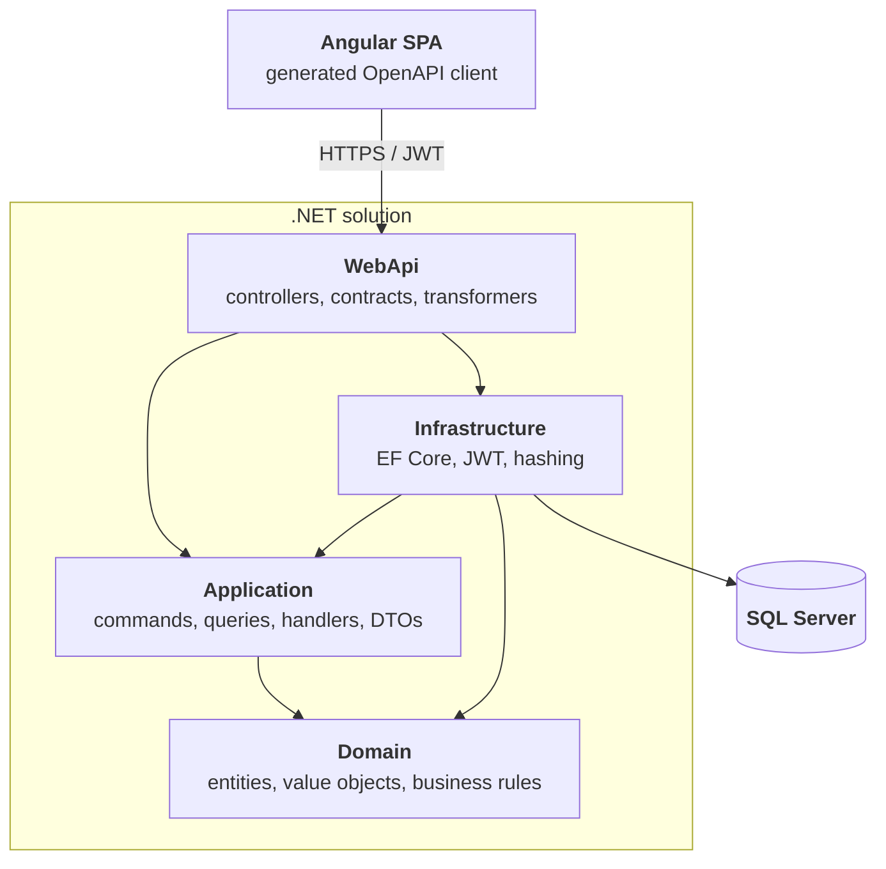

# Ticket Booking Platform

A demo event ticketing platform built as a portfolio project to showcase **.NET backend
engineering with Clean Architecture**, exposing a versioned **REST API** consumed by an
**Angular SPA** through a generated OpenAPI client.

---

## Tech stack

### Backend

| Area | Technology |
|---|---|
| Framework | .NET 9 |
| Web | ASP.NET Core Web API, REST endpoints |
| Persistence | Entity Framework Core 9, code-first migrations |
| Database | SQL Server |
| Architecture | Clean Architecture (Domain / Application / Infrastructure / WebApi) |
| Application layer | CQRS-style commands & queries with hand-written handlers (no MediatR) |
| AuthN / AuthZ | JWT Bearer tokens, role-based policies (`User`, `Organizer`, `Admin`) |
| Password hashing | ASP.NET Core Identity `PasswordHasher` |
| API versioning | URL segment (`/api/v{version}/...`), v1 & v2 documents |
| API docs | Built-in OpenAPI + Scalar UI |
| Error handling | `IExceptionHandler` + RFC 7807 `ProblemDetails` |
| Health checks | ASP.NET Core health checks (`/health/live`, `/health/ready`) |
| Observability | OpenTelemetry traces, metrics and logs exported over OTLP |
| Configuration | Layered `appsettings.json` → user secrets → environment variables |
| Testing | xUnit, FluentAssertions, NSubstitute, EF Core InMemory & SQLite, `WebApplicationFactory` integration tests |

### Frontend

| Area | Technology |
|---|---|
| Framework | Angular 22 |
| UI | Angular Material |
| Language / styling | TypeScript, SCSS |
| API client | Generated from OpenAPI via `openapi-generator-cli` |
| Cross-cutting | HTTP interceptors (auth token, timeout), route guards (`authGuard`, `roleGuard`) |
| Testing | Vitest (via `ng test`) |

---

## Architecture



Dependency rule: `Domain` has no project references. `Application` depends only on `Domain` and
defines its own abstractions (`IApplicationDbContext`, `IJwtTokenGenerator`, `IPasswordHasher`,
`ICurrentUserService`), which `Infrastructure` and `WebApi` implement — so the flow of control
points inward while the flow of dependencies is inverted at the boundaries.

```
src/
├── Domain/          Events, Locations, Orders, Tickets, Users + Money value object, TicketCode generator
├── Application/     Feature-per-folder CQRS handlers, DTOs, paging helpers, exceptions
├── Infrastructure/  ApplicationDbContext, configurations, migrations, seeding, JWT, hashing, Key Vault
├── Migrator/        Standalone migrator container (applies migrations + seeds before the API starts)
└── WebApi/          V1 & V2 controllers, request contracts, OpenAPI transformers, health checks, Program.cs
tests/
├── Domain.Tests/          Aggregate invariants & business rules
├── Application.Tests/     Handler behaviour against EF Core InMemory + NSubstitute doubles
├── Infrastructure.Tests/  Persistence (EF Core on SQLite), seeding, JWT and password hashing
└── WebApi.Tests/          Unit tests + WebApplicationFactory integration tests (auth, versioning, errors, health)
frontend/
└── ticket-booking-web/  Angular SPA
```

---

## Key technical decisions

- **Clean Architecture over a "services + repositories" CRUD stack.** Business rules live in the
  domain aggregates (`Event.Publish()`, `Order.Pay()`, `TicketCategory` capacity checks), not in
  controllers or handlers.
- **No MediatR.** Handlers are plain classes registered explicitly in `AddApplication()`. It keeps
  the call stack navigable (F12 goes straight to the handler), removes a licensing/runtime
  dependency, and shows the pattern is understood rather than imported.
- **No AutoMapper.** Mapping is explicit (e.g. `OrderMapper`), so projections are compile-time
  checked and there is no reflection-based magic between layers.
- **Domain exceptions mapped centrally.** `BusinessRuleException`, `NotFoundException` and
  `ConflictException` are translated into `ProblemDetails` by a single `GlobalExceptionHandler`,
  so controllers contain no try/catch noise.
- **URL-segment API versioning from day one.** v2 exists to demonstrate coexisting contracts
  (`/api/v1/Events` vs `/api/v2/Events`) with separate OpenAPI documents per version.
- **OpenAPI-driven frontend.** Controllers use explicit action and route names so generated client
  methods stay clean (`getEvents()` rather than `apiV1EventsGet()`); the TypeScript client is
  generated, never hand-written.
- **Secrets stay out of the repo.** Connection string defaults to LocalDB; JWT signing key and the
  seeded admin credentials are read from user secrets / environment variables and the app fails
  fast at startup if they are missing.
- **Migrations are a separate deployment step.** A dedicated `migrator` container (see
  `src/Migrator`) applies migrations and seeds reference data before the API starts, so the API can
  run with multiple replicas without racing on the schema. In-process migration is restricted to the
  Development environment.

---

## Getting started

**Prerequisites:** .NET SDK 9.0+, SQL Server LocalDB (or any SQL Server instance), Node.js 24 for the
frontend (the Angular CLI comes with the project, no global install needed). Optional: Docker for the
containerised stack, and Java 11+ only to regenerate the API client (`npm run generate:api` uses
`openapi-generator-cli`).

```powershell
git clone https://github.com/muszkab/TicketBookingPlatform.git
cd TicketBookingPlatform
```

Configure the required secrets:

```powershell
dotnet user-secrets --project src/WebApi set "JwtSettings:SigningKey" "<at-least-32-character-random-key>"
dotnet user-secrets --project src/WebApi set "Seed:Admin:Email" "admin@example.com"
dotnet user-secrets --project src/WebApi set "Seed:Admin:Password" "<strong-password>"
```

Run the API (in Development it applies migrations and seeds reference data on startup):

```powershell
dotnet run --project src/WebApi
```

> In containers the API no longer migrates on startup: a one-shot `migrator` container applies
> migrations and seeds the reference data before the API replicas start. `docker compose up` wires
> this up automatically via `depends_on: condition: service_completed_successfully`, which keeps the
> API safe to scale out.

| Endpoint | URL |
|---|---|
| API | `https://localhost:5001/api/v1/...` |
| Build & runtime info | `https://localhost:5001/api/v1/meta` (anonymous, feeds the SPA footer) |
| Scalar API reference | `https://localhost:5001/scalar` |
| OpenAPI documents | `/openapi/v1.json`, `/openapi/v2.json` |

Run the tests:

```powershell
dotnet test
```

Run the frontend:

```powershell
cd frontend/ticket-booking-web
npm install
npm start   # https://localhost:4200
```

Or run the whole stack (SQL Server, migrator, API, SPA) with Docker Compose:

```powershell
Copy-Item .env.example .env   # then replace the placeholder secrets
docker compose up -d --build
```

Keep `--build`: without it Compose silently reuses an existing local image, even after code changes.

| Service | URL |
|---|---|
| SPA | `http://localhost:4200` (`SPA_PORT`) |
| API | `http://localhost:8080/api/v1/...` (`API_PORT`) |
| Scalar API reference | `http://localhost:8080/scalar` |

SQL Server publishes no host port. `db/backup` is mounted read-only into the container at
`/var/opt/mssql/backup`, so an existing `.bak` can be restored from there.

To run the published images instead of building locally:

```powershell
$env:IMAGE_TAG = "2.4.0"   # any published semver tag, e.g. 2.4.0, 2.4 or 2
docker compose -f docker-compose.yml -f docker-compose.publishedimage.yml up -d
```

The `publish-images` job runs on `v*.*.*` tags only and publishes each image with the full version,
the major.minor and the major tag (e.g. `2.3.0`, `2.3`, `2`). There is deliberately **no `latest`
tag**, so an explicit version has to be pinned for every deployment. The migrator image only exists
from `2.0.0` onwards (it was introduced together with the standalone migrator), so the API and the
migrator must always run the same tag.

The git tag is the single source of truth for the release version, and every artifact bakes it in at
build time: the .NET images via the `APP_VERSION` build arg (`-p:Version`), the SPA via
`scripts/generate-version.cjs`. The SPA footer shows the SPA build version, its tooltip adds the
commit, the build date and the API version reported by `/api/v1/meta` — so a mismatch between the
SPA and the API is visible at a glance.

---

## Configuration

Configuration is layered: `appsettings.json` holds non-secret defaults, `appsettings.Development.json`
overrides them for local development, and **user secrets / environment variables** provide the
secrets. No connection string or secret is committed to the repository.

In containers the environment variables use the **`__` (double underscore) separator** to address
nested keys, e.g. `JwtSettings__SigningKey` maps to `JwtSettings:SigningKey`.

| Setting | `appsettings.json` key | Environment variable | Notes |
|---|---|---|---|
| Connection string | `ConnectionStrings:DefaultConnection` | `ConnectionStrings__DefaultConnection` | Required. Development uses LocalDB; containers use the SQL Server service. |
| JWT signing key | `JwtSettings:SigningKey` | `JwtSettings__SigningKey` | Required, at least 32 characters. Startup fails fast if missing. |
| JWT issuer / audience / lifetime | `JwtSettings:Issuer`, `JwtSettings:Audience`, `JwtSettings:AccessTokenExpirationMinutes` | `JwtSettings__Issuer`, `JwtSettings__Audience`, `JwtSettings__AccessTokenExpirationMinutes` | Non-secret defaults live in `appsettings.json`. |
| Seed administrator | `Seed:Admin:Email`, `Seed:Admin:Password` | `Seed__Admin__Email`, `Seed__Admin__Password` | Required by the migrator; the admin account is always seeded (idempotently). |
| Demo fixtures | `Migrator:SeedDemoData` | `Migrator__SeedDemoData` | Migrator only. `false` (default) seeds just the admin; Docker Compose sets `true` to also load locations, events and ticket categories. |
| Startup migration | `Database:MigrateOnStartup`, `Database:SeedOnStartup` | `Database__MigrateOnStartup`, `Database__SeedOnStartup` | **Development only** (single instance). Anywhere else the app fails fast — use the migrator container instead. |
| OTLP endpoint | `OpenTelemetry:OtlpEndpoint` | `OpenTelemetry__OtlpEndpoint` | Empty = telemetry export disabled. Docker Compose binds it to `OTEL_EXPORTER_OTLP_ENDPOINT` from `.env`. |
| Key Vault | `KeyVault:Uri` | `KeyVault__Uri` | Empty = Key Vault is not used (local development, Docker Compose). Set to `https://<vault>.vault.azure.net/` in Azure. |
| Key Vault identity | `KeyVault:ManagedIdentityClientId` | `KeyVault__ManagedIdentityClientId` | Only needed for a *user-assigned* Managed Identity; leave empty for system-assigned. |
| CORS origins | `Cors:AllowedOrigins` | `Cors__AllowedOrigins__0`, `Cors__AllowedOrigins__1`, … | Empty array = the CORS middleware is not registered. |
| HTTPS behaviour | `Https:RedirectEnabled`, `Https:HstsEnabled` | `Https__RedirectEnabled`, `Https__HstsEnabled` | Set to `false` in containers (TLS terminates at the proxy). |
| Forwarded headers | `ForwardedHeaders:Enabled` | `ForwardedHeaders__Enabled` | Enable behind a reverse proxy / Container Apps so `X-Forwarded-For` and `X-Forwarded-Proto` are honoured. |
| OpenAPI / Scalar | `OpenApi:Enabled` | `OpenApi__Enabled` | Exposes the OpenAPI documents and the Scalar UI. |
| Log level | `Logging:LogLevel:Default` | `Logging__LogLevel__Default` | |

Fail-fast validation covers the connection string, the JWT `SigningKey` and the seed administrator
credentials, so a misconfigured deployment stops at startup instead of failing later.

### Azure Key Vault

When `KeyVault:Uri` is set, both the API and the migrator load an additional configuration source
from Key Vault, authenticated with `DefaultAzureCredential` (the developer's `az login` session
locally, a Managed Identity in Azure — no secret is needed to read the secrets). The provider is
opt-in, so local development and Docker Compose keep using user secrets and environment variables.

Key Vault secret names cannot contain `:`, so the nested keys use `--` instead:

| Configuration key | Key Vault secret name |
|---|---|
| `ConnectionStrings:DefaultConnection` | `ConnectionStrings--DefaultConnection` |
| `JwtSettings:SigningKey` | `JwtSettings--SigningKey` |
| `Seed:Admin:Password` | `Seed--Admin--Password` |

The identity needs the **Key Vault Secrets User** role on the vault.

### SPA runtime configuration

The SPA image is built once and reused across environments, so the API base path is **not** baked
into the bundle. It is served as `config.json` next to `index.html` and fetched before Angular
bootstraps:

```json
{ "apiBasePath": "" }
```

| Value | When |
|---|---|
| `""` (empty) | Behind a same-origin proxy — the nginx container proxies `/api/` to the API, so relative requests just work and **no CORS is involved**. This is what Docker Compose uses. |
| `"https://<api-host>"` | SPA and API on different domains (Static Web Apps + Container Apps). The API must then allow that origin through `Cors:AllowedOrigins`. |

In Azure the SPA calls the API directly, see [SPA and CORS](#spa-and-cors).

If `config.json` is missing or malformed the compile-time default from `src/environments` is kept,
so a broken deployment artifact cannot prevent the application from starting. nginx serves the file
with `Cache-Control: no-store`, otherwise a redeployed environment could keep using a stale API URL.

Docker Compose reads its variables from a `.env` file (see `.env.example`): `MSSQL_SA_PASSWORD`,
`MSSQL_DATABASE`, `JWT_SIGNING_KEY`, `SEED_ADMIN_EMAIL`, `SEED_ADMIN_PASSWORD`, `API_PORT`,
`SPA_PORT`, `OTEL_EXPORTER_OTLP_ENDPOINT`.

---

## Health & observability

### Health endpoints

| Endpoint | Check | Purpose |
|---|---|---|
| `/health/live` | `self` — the process is running, no dependencies | Liveness probe; polled by the Docker Compose healthcheck and the Container Apps liveness/startup probes. |
| `/health/ready` | `database` — EF Core can reach SQL Server | Readiness probe; decides whether the instance should receive traffic. |

Both endpoints are anonymous and currently return `Healthy` / `Unhealthy` as plain text. In local
development they are served from the API root, e.g. `https://localhost:5001/health/live`.

### OpenTelemetry

The API is instrumented with OpenTelemetry and exports over OTLP when an endpoint is configured:

- **Traces** — incoming ASP.NET Core requests and EF Core queries.
- **Metrics** — ASP.NET Core/Kestrel and .NET runtime metrics (GC, thread pool).
- **Logs** — the existing `ILogger` output, including scopes and formatted messages.

Resource attributes include `service.name = TicketBookingPlatform.WebApi` and the service version.
The `GlobalExceptionHandler` adds a `traceId` to every `ProblemDetails` response, so a reported error
can be located in the traces.

Exporting is a no-op when the endpoint is empty. To inspect telemetry locally, point the API at the
optional Aspire Dashboard and start it with the `observability` profile:

```powershell
# .env
OTEL_EXPORTER_OTLP_ENDPOINT=http://aspire-dashboard:18889
```

```powershell
docker compose --profile observability up -d
# Dashboard: http://localhost:18888
```

Outgoing `HttpClient` instrumentation is intentionally not wired up yet — the API makes no outbound
calls. It should be added with the first external integration (e.g. a payment provider).

---

## Continuous integration

`.github/workflows/ci.yml` runs on every push and pull request to `master`, and on `v*.*.*` tags:

| Job | Runs on | What it does |
|---|---|---|
| Backend build & test | every run | Restore, build and `dotnet test`, with a published test report. |
| Frontend build & test | every run | `npm ci`, `npm test` (Vitest) and `npm run build`; on tags it first sets the `package.json` version from the tag. |
| Docker Compose smoke test | every run | Builds the images, starts the full stack, checks the migrator exit code, API readiness, the SPA, and an anonymous + an authenticated endpoint. |
| OpenAPI drift check | disabled | Compares the live OpenAPI document with the committed `openapi/v1.json`; switched off (`if: false`) until it is stabilised. |
| Publish images | tags only | Pushes the `api`, `migrator` and `spa` images to GHCR. |
| Smoke-test published images | tags only | Starts the just-published images with `docker-compose.publishedimage.yml`. |
| Deploy API, Deploy SPA | tags only | See [Releasing a new version](#releasing-a-new-version). |

Dependabot (`.github/dependabot.yml`) opens weekly, grouped pull requests for NuGet, npm, Docker base
images, Compose images and GitHub Actions. Major upgrades of .NET, Angular, TypeScript, Node and
FluentAssertions (v8+ is commercially licensed) are ignored on purpose and done by hand (TFM change,
`ng update`).

---

## Azure deployment

The API runs on Azure Container Apps against Azure SQL, with every secret in Key Vault. **No password
exists anywhere in the system** — neither in the images, nor in the app configuration, nor in the
vault: the connection string itself uses a Managed Identity.

| Resource | Role |
|---|---|
| Container App (`api`) | Runs the published API image, HTTP ingress on **port 8080**. |
| Container Apps Job (`migrator`) | Manually triggered, one-shot EF Core migration + seeding. `parallelism = 1`, so two migrations can never run at the same time (replica timeout 600 s, 1 retry). |
| Azure SQL Database | Application database, reached with Entra authentication. |
| Key Vault | Connection string, JWT signing key and seed admin password. |
| Static Web App | Hosts the SPA (Free tier) and calls the API directly, with CORS. |
| Log Analytics workspace | Console and system logs of the environment. |

Both the app and the job have their own **system-assigned Managed Identity**, each granted the
**Key Vault Secrets User** role. The database permissions are deliberately asymmetric:

```sql
-- API: reads and writes data, but cannot change the schema
CREATE USER [<container-app-name>] FROM EXTERNAL PROVIDER;
ALTER ROLE db_datareader ADD MEMBER [<container-app-name>];
ALTER ROLE db_datawriter ADD MEMBER [<container-app-name>];

-- Migrator job: the only identity allowed to change the schema
CREATE USER [<job-name>] FROM EXTERNAL PROVIDER;
ALTER ROLE db_ddladmin   ADD MEMBER [<job-name>];
ALTER ROLE db_datareader ADD MEMBER [<job-name>];
ALTER ROLE db_datawriter ADD MEMBER [<job-name>];
```

The passwordless connection string stored in the vault:

```
Server=tcp:<server>.database.windows.net,1433;Initial Catalog=TicketBookingPlatform;Authentication=Active Directory Managed Identity;Encrypt=True;TrustServerCertificate=False;
```

Container App environment variables (the secrets come from the vault, not from here):
`KeyVault__Uri`, `ASPNETCORE_ENVIRONMENT=Production`, `ForwardedHeaders__Enabled=true`,
`Https__RedirectEnabled=false`, `Https__HstsEnabled=false` — TLS terminates at the ingress.

### Releasing a new version

Tag the commit (`git tag v2.2.0 && git push origin v2.2.0`). From there the pipeline is automatic:

1. CI builds and tests, publishes the images and smoke-tests them.
2. `deploy-api.yml` points the migrator job at the new image, **runs it to completion**, and only then
   creates the new API revision. Container Apps routes traffic once `/health/ready` reports healthy
   and the previous revision stays active if the new one never does. The workflow finishes when
   `GET /api/v1/meta` reports the released version and `/health/ready` answers 200.
3. `deploy-spa.yml` uploads the SPA — only after the API is live.

A failed migration stops the pipeline before the API or the SPA change. A database migration does
not roll back with the revision, and the old API briefly runs against the new schema, so migrations
must stay backwards compatible with the previous release (expand first, contract in a later release).

Both deploy workflows can also be started by hand (*Run workflow*); `deploy-api.yml` asks for the
version to deploy, which makes a redeploy or a rollback to an older release a single click.

### Deploying the API

`.github/workflows/deploy-api.yml` signs in to Azure with **OIDC** (a federated credential), so no
client secret is stored in GitHub. The job runs in the `production` GitHub Environment, which is also
what the federated credential trusts. Add *required reviewers* to that environment if you ever want a
manual approval step before a deploy.

One-time Azure setup:

```bash
appId=$(az ad app create --display-name github-ticketbooking-deploy --query appId -o tsv)
az ad sp create --id $appId

az ad app federated-credential create --id $appId --parameters '{
  "name": "github-production",
  "issuer": "https://token.actions.githubusercontent.com",
  "subject": "repo:<owner>@<owner-id>/<repo>@<repo-id>:environment:production",
  "audiences": ["api://AzureADTokenExchange"]
}'

az role assignment create --assignee $appId --role Contributor \
  --scope /subscriptions/<subscription-id>/resourceGroups/rg-ticketbooking
```

The subject must match what GitHub actually presents. For this repository GitHub sends the **ID-based**
form (`repo:<owner>@<owner-id>/<repo>@<repo-id>:environment:production`, the numeric ids come from
`https://api.github.com/repos/<owner>/<repo>`), not the plain `repo:<owner>/<repo>:...` one. If the login
fails with `AADSTS700213`, copy the *subject claim* printed by the `azure/login` step into the credential.

Prerequisites in the GitHub repository (create the `production` environment first; all three are
**environment secrets** of `production`, like the Static Web Apps token below):

| Kind | Name | Value |
|---|---|---|
| Environment secret | `AZURE_CLIENT_ID` | The `appId` of the app registration above. |
| Environment secret | `AZURE_TENANT_ID` | The Entra tenant id. |
| Environment secret | `AZURE_SUBSCRIPTION_ID` | The subscription that holds `rg-ticketbooking`. |

The resource names (`rg-ticketbooking`, `containerapp-ticketbooking-api`,
`job-ticketbooking-migrator`) are set in the workflow's `env` block. The images are public on GHCR,
so the Container App needs no registry credentials.

### Probes

Map the health endpoints to the container probes (`/health/live` for liveness and startup,
`/health/ready` for readiness, port `8080`). Give the startup probe a generous window (an initial
delay of about 10 s and a failure threshold of about 30 work well): the app needs a few seconds to
read the vault and warm up, and the first `/health/ready` call also pays for acquiring the Managed
Identity token. "Probe of StartUp failed" entries before that are just noise.

### SPA and CORS

The SPA is hosted on Azure Static Web Apps and calls the Container App **directly**, so the two run
on different origins and CORS is required. Two settings have to match:

1. The SPA's `config.json` — `apiBasePath` set to the Container App URL.
2. The API — `Cors__AllowedOrigins__0` set to the Static Web Apps URL.

```
Cors__AllowedOrigins__0 = https://<spa-name>.azurestaticapps.net
```

The CORS middleware is only registered when the list is non-empty, which is why local development
and Docker Compose (where nginx proxies `/api/` on the same origin) need no CORS configuration at
all. Every additional origin — a custom domain or a staging slot — needs its own indexed entry
(`Cors__AllowedOrigins__1`, ...); the policy uses `AllowCredentials`, so wildcards are not allowed.

> The alternative would be the Static Web Apps *linked backend* feature, which proxies the API under
> the SPA origin and removes the need for CORS entirely. It requires the Standard plan, so the
> direct-call approach above was chosen instead.

### Deploying the SPA

`.github/workflows/deploy-spa.yml` builds the Angular application and uploads it to Static Web Apps.
On a `v*.*.*` tag it is called from `ci.yml` once the API deploy has succeeded; it can also be run on
demand via *Run workflow*. It writes `config.json` into the build
output from the `API_BASE_PATH` variable, so the same source produces the right API URL
per environment. A manual run can override it with the `api_base_path` input; if neither is set, the
workflow fails instead of shipping an SPA without an API URL.

Prerequisites in the GitHub repository:

| Kind | Name | Value |
|---|---|---|
| Environment secret (`production`) | `AZURE_STATIC_WEB_APPS_API_TOKEN` | The deployment token from the Static Web App (*Overview → Manage deployment token*). |
| Environment variable (`production`) | `API_BASE_PATH` | The Container App URL, e.g. `https://<app>.<region>.azurecontainerapps.io`. |

`public/staticwebapp.config.json` handles the routing: unknown paths fall back to `index.html` (the
Angular router owns them) and `config.json` is served with `Cache-Control: no-store`.

When creating the Static Web App in the portal, choose **Deployment source: Other** — the workflow
above already does the build and upload, so Azure should not generate its own.

---

## Feature overview

Event & location management (admin/organizer), event publishing and cancellation, ticket categories
with capacity limits, catalogue browsing with paging and filtering, JWT login, cart and checkout,
order payment/cancellation, and issued tickets with QR codes.

## Known limitations

- **Data Protection keys are not persisted.** They live in the container file system, separately per
  replica. This is harmless today (the JWT uses its own symmetric key and the API is stateless), but
  they must move to Blob Storage + Key Vault (`PersistKeysToAzureBlobStorage`,
  `ProtectKeysWithAzureKeyVault`) before cookies, antiforgery tokens or `IDataProtector` are used.
- **Docker Compose connects as `sa`.** Azure already uses least-privilege identities; locally a
  dedicated app login (`db_datareader` / `db_datawriter`) and a migrator login (`db_ddladmin`) are
  still to do.
- **Health responses are plain text**, and the database check has no explicit timeout.
- **`OpenTelemetry.Instrumentation.EntityFrameworkCore` is a beta package**; it should be updated
  once a stable version is released.
- **No admin order management in the SPA yet** (order list, manual status change, refunds).

## Roadmap

- [ ] Upgrade to .NET 10 (LTS)
- [x] Docker Compose (SQL Server + API + SPA)
- [ ] FluentValidation for command/query input validation
- [ ] Testcontainers (real SQL Server) for the integration tests
- [x] CI/CD pipeline (build, test, OpenAPI drift check, container image publish)
- [x] Cloud-native readiness (health checks, OpenTelemetry, externalised configuration)
- [x] Deployment to Azure (Container Apps + Azure SQL + Static Web Apps, secrets in Key Vault)
